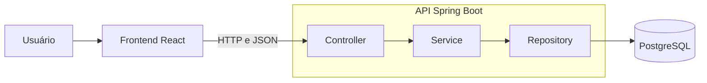

# Arquitetura inicial

O OSI terá dois projetos no mesmo repositório.  
A pasta `frontend/` abrigará a aplicação React com TypeScript e Vite, e a pasta `backend/` abrigará a API REST com Java 25 e Spring Boot.  
Cada projeto terá seu próprio build e o acesso aos dados será pela API.

## Responsabilidades

- O **frontend** exibe o formulário e a fila, envia as ações do usuário e destaca o primeiro item na ordem devolvida pela API.
- O **controller** recebe as requisições, valida o formato dos dados de entrada e traduz o resultado para uma resposta HTTP.
- O **service** aplica as regras da solicitação, como preservar a data de entrada ao alterar a prioridade e define a operação que precisa ser persistida.
- O **repository** usa Spring Data JPA para ler e gravar solicitações. A consulta da fila seleciona os itens ativos do departamento responsável e aplica os [critérios de ordenação](regras-da-fila.md).

## Decisões e limites

| Decisão | Motivo e consequência |
| --- | --- |
| React com Vite e API REST independente | A interface consome a API pelo navegador e pode ser publicada como site estático. Consideramos Next.js, mas o escopo atual é um formulário e uma fila interativa, sem requisitos de renderização no servidor. |
| Java com Spring Boot | Escolhemos Java para demonstrar o desenvolvimento e os testes de uma API nessa stack. Node.js permitiria usar a mesma linguagem nos dois projetos, enquanto Java requer um segundo ambiente de build e execução. |
| PostgreSQL com migrations SQL do Flyway | As mudanças no esquema ficam versionadas e podem ser aplicadas a partir de um banco vazio. O Hibernate valida o esquema na inicialização, e o Flyway aplica as mudanças. |

## Execução e publicação previstas

- **No ambiente local**, Docker Compose reúne frontend, API e PostgreSQL. Um volume do banco preserva os dados ao recriar o container.
- **Nos testes**, usaremos JUnit para as regras do backend, PostgreSQL nos testes de integração das consultas da fila e Vitest para o frontend.
- **Na demo**, o Render hospedará o frontend estático e a API em container, com PostgreSQL no Neon. O primeiro acesso após inatividade pode levar mais tempo enquanto a API gratuita volta a subir.
- **Na integração**, GitHub Actions executará build e testes nos PRs e na `main`. A demo será atualizada a partir da `main` após as verificações.
