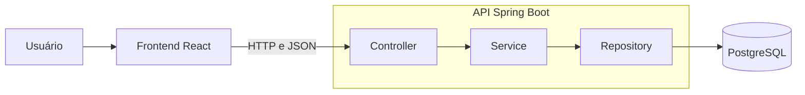

# Arquitetura inicial

O OSI terá dois projetos no mesmo repositório.  
A pasta `frontend/` abrigará a aplicação React com TypeScript e Vite, e a pasta `backend/` abrigará a API REST com Java 25 e Spring Boot.  
Cada projeto terá seu próprio build e o acesso aos dados será pela API.

## Responsabilidades

- O **frontend** exibe o formulário e a fila, envia as ações do usuário e destaca o primeiro item na ordem devolvida pela API.
- O **controller** recebe as requisições, valida o formato dos dados de entrada e traduz o resultado para uma resposta HTTP.
- O **service** aplica as regras da solicitação, como preservar a data de entrada ao alterar a prioridade e define a operação que precisa ser persistida.
- O **repository** usa Spring Data JPA para ler e gravar solicitações. A consulta da fila seleciona os itens ativos do departamento responsável e aplica os [critérios de ordenação](regras-da-fila.md).

## Decisões e limites

| Decisão | Motivo e consequência |
| --- | --- |
| React com Vite e API REST independente | A interface consome a API pelo navegador e pode ser publicada como site estático. Consideramos Next.js, mas o escopo atual é um formulário e uma fila interativa, sem requisitos de renderização no servidor. |
| Java com Spring Boot | Escolhemos Java para demonstrar o desenvolvimento e os testes de uma API nessa stack. Node.js permitiria usar a mesma linguagem nos dois projetos, enquanto Java requer um segundo ambiente de build e execução. |
| PostgreSQL com migrations SQL do Flyway | As mudanças no esquema ficam versionadas e podem ser aplicadas a partir de um banco vazio. O Hibernate valida o esquema na inicialização, e o Flyway aplica as mudanças. |

## Execução e publicação previstas

- **No ambiente local**, Docker Compose sobe o PostgreSQL. A API é executada pelo Maven Wrapper e o frontend pelo Vite. Um volume preserva os dados ao recriar o container do banco.
- **Nos testes**, usaremos JUnit para as regras do backend, PostgreSQL nos testes de integração das consultas da fila e Vitest para o frontend.
- **Na demo**, o Render hospedará o frontend estático e a API em container, com PostgreSQL no Neon. O primeiro acesso após inatividade pode levar mais tempo enquanto a API gratuita volta a subir.
- **Na integração**, GitHub Actions executará build e testes nos PRs e na `main`. A demo será atualizada a partir da `main` após as verificações.

### Primeira publicação da demo

O objetivo é disponibilizar o fluxo de cadastro, consulta da fila, alteração de prioridade e conclusão em um link público.

1. Proteger o fluxo da demo com uma tela de acesso e validação de sessão na API.
2. Empacotar a API Java 25 em uma imagem Docker e validar seu funcionamento com o PostgreSQL local. No Render, configurar a API para aceitar `PORT` e ativar o perfil com `SPRING_PROFILES_ACTIVE=producao`. [Web Services no Render](https://render.com/docs/web-services)
3. Criar um banco dedicado à demo no Neon e configurar a conexão JDBC com TLS no serviço da API. Usar `SPRING_DATASOURCE_URL`, `SPRING_DATASOURCE_USERNAME` e `SPRING_DATASOURCE_PASSWORD` no ambiente do Render. O Flyway aplica as migrations na inicialização. [Guia do Neon para Java](https://neon.com/docs/guides/java)
4. Publicar o build do Vite como site estático e testar uma regra de reescrita de `/api/*` para a API. Isso permite manter as chamadas relativas que o frontend já usa. Validar o cookie de sessão e as requisições `GET`, `POST` e `PATCH` a partir do endereço público. [Regras de reescrita do Render](https://render.com/docs/redirects-rewrites)

A publicação está pronta quando for possível abrir o link em uma janela anônima, entrar com o código de acesso, cadastrar uma solicitação de exemplo, localizá-la na fila, alterar a prioridade e concluí-la. A verificação inclui o bloqueio de chamadas diretas sem sessão e o retorno à tela de acesso quando a sessão expira. O README receberá o link depois dessa verificação.

### Acesso e disponibilidade da demo

- A tela inicial pede um código de acesso compartilhado com os avaliadores. A API valida o código, mantido nas variáveis de ambiente do backend, e exige uma sessão válida nas rotas de consulta e alteração dos dados da demo.
- A primeira tentativa com código incorreto abre uma janela de um minuto para o IP de origem. Após cinco tentativas incorretas, novas tentativas desse IP recebem `429 Too Many Requests` até a janela terminar. O cabeçalho `Retry-After` informa quantos segundos aguardar.
- A sessão é mantida pelo backend. Em produção, o cookie de sessão usa `Secure`, `HttpOnly` e `SameSite=Strict`. Após 10 minutos sem requisições autenticadas, a API responde `401` às rotas protegidas e a interface retorna à tela de acesso. O código permanece válido para iniciar outra sessão até ser trocado. [Gerenciamento de sessões da OWASP](https://cheatsheetseries.owasp.org/cheatsheets/Session_Management_Cheat_Sheet.html)
- O botão **Verificar conexão** na tela de acesso faz uma requisição pública de disponibilidade, que também inicia a API se ela estiver em pausa. A tela indica que a conexão está sendo verificada e permite nova tentativa se o serviço estiver indisponível. A verificação é manual para evitar tráfego em segundo plano. [Pausa por inatividade no Render](https://render.com/docs/free#spinning-down-on-idle)
